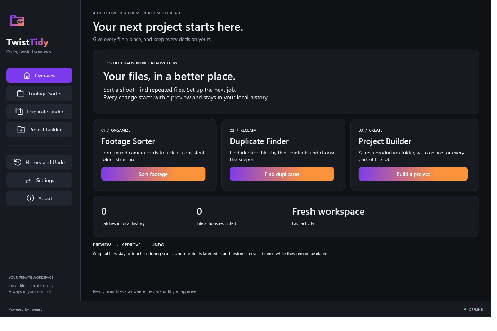

# TwistTidy

**[Download for Windows](https://github.com/twistkan/twist-tidy/releases/download/snapshot-2026-11-04/TwistTidySetup.exe)** · [Release notes and checksums](https://github.com/twistkan/twist-tidy/releases/tag/snapshot-2026-11-04)

[](https://www.yotip.me/twistkan)

**Order, twisted your way. Powered by Tweest.**

A native, offline Windows file organizer for video production. Built from the supplied specification with C#, .NET 8, WPF, and no third-party application packages.

## Screenshot



## Start using the app

You do not need Visual Studio, the SDK, or a separate .NET installation to use the supplied executables.

1. Open `dist\TwistTidySetup.exe` and click **Install TwistTidy**. This installs for your Windows account and offers a desktop shortcut. Installation does not scan or change your work files.
2. Or open `dist\TwistTidy\TwistTidy.exe` directly for portable use.
3. Pick **Footage Sorter**, **Duplicate Finder**, or **Project Builder**.
4. Choose folders and options, then generate a preview. A scan does not move or delete anything.
5. Review the table, untick unwanted rows, and click **Approve selected**. Confirm the displayed summary.
6. Use **History and Undo** to select a batch, preview its undo, and approve the rows to restore.

The app requires 64-bit Windows with support for .NET 8 WPF. It has been built and exercised on this Windows PC; testing on a separate clean PC has not been performed. Executables are not digitally signed.

## What is included

- **Footage Sorter:** recursive scanning; all requested video, photo, audio and project extensions; type/date/source/resolution tokens; editable camera rules; preset saving; suffixes for name clashes. Files already at their exact planned destination are skipped.
- **Duplicate Finder:** size grouping, three-region partial hashes, then full SHA-256; oldest-modified or deepest-folder keeper suggestion; change the keeper; minimum size and extension filters; Settings exclusions; image preview; per-file paths and size; recycle or move to a review folder. Keeper contents are locked against writing during an approved batch.
- **Project Builder:** client/project/date/type fields, customizable project name pattern, four built-in templates, nested folder previews, optional README, and a follow-up route into the sorter. Selected children implicitly require their parent directories.
- **Template editor:** add root/child folders, rename/remove/reorder, nest/unnest, new templates, JSON import/export. Changes apply when you save.
- **History:** separate durable JSON journal per batch, partial/cancelled operations and errors, full batch undo preview, content checks before restoring moved files, and interrupted-operation recovery where the recorded filesystem state proves the action completed.
- **Appearance:** dark/light theme, editable accent color, vector logo and navigation icons, seven-size executable icon, splash, and persistent branding/offline footer.
- **Delivery:** standalone executable, per-user setup executable, complete source solution, readable full-source listing, tests, screenshots and verification notes.

## Media information and fallbacks

The app uses Windows' installed **local Shell metadata handlers**, without downloading codecs or invoking an external process. Metadata availability depends on format and installed handlers. Photo date-taken is preferred, then media encoded date where supplied. An encoded date is explicitly labeled as such because it may differ from the actual shoot date. Modified date is the final fallback and is labeled in the preview. Resolution and duration are shown when available. Unreadable resolution goes into `Unknown resolution` when grouped that way. BRAW, R3D and other proprietary formats may have no readable metadata on a particular PC.

Camera rules are filename prefixes, not camera identification from image content. The default Sony `C` rule requires a `C0001`-style filename. The deepest-folder keeper rule is a simple organization heuristic; review its suggestion before approval.

## Safety and undo

- No scan modifies originals. Approval applies only the selected preview rows.
- Windows, Program Files, ProgramData, AppData, drive roots, network paths, Recycle Bin contents and system-volume folders are protected. Junctions and symbolic links are rejected. Use a specific local work folder.
- Planning resolves clashes with numeric suffixes. If a destination appears after preview, the action is skipped and a fresh preview is required. It never overwrites it during a file operation.
- Source length, modified time and (for duplicates) full content hash are rechecked. Files are held against writers while being hashed and moved. A duplicate group requires an unchanged keeper.
- A batch is journaled before each mutation and after completion. A crash can leave a `Pending` or `Undo pending` record. Undo reconciles provable completed moves/restores. Ambiguous records are left alone for manual review. This is not a replacement for a separate backup or a guarantee against hardware failure.
- Cancellation stops before the next safe operation. It does not interrupt a Shell recycle operation or a move already in progress. Completed actions remain in History.
- Undo never replaces an existing file. The undo preview reserves a numeric suffix for a restore clash. A new clash after that preview causes a skip.
- Undo checks content hashes so later edits are preserved. It removes only empty directories created by the batch. An untouched generated README is recycled during undo; edited READMEs are left in place.
- Recycle uses the Windows Shell's explicit recycle flag. Restore uses the current account's matching `$I`/`$R` record and verifies contents. Items must remain in the Recycle Bin. Emptying the bin, automatic bin cleanup, or external changes can make restoration unavailable. Use Windows Recycle Bin directly if a Shell record cannot be located.
- Recycle actions require a fixed local disk. For removable media, use **Move to review folder**.
- The duplicate space figure is the selected files' logical size, not a measurement of newly available disk space. Recycling keeps data on the drive until the bin is emptied; review-folder moves do not reclaim disk space. Hard links, filesystem compression and deduplication can change actual physical savings.

## Your local data

Settings and templates: `%AppData%\TwistTidy\settings.json`.

History: `%AppData%\TwistTidy\History\<batch-id>.json`.

Malformed JSON is preserved and a warning is shown; readable history entries remain available. Saving settings replaces the old settings file, so copy a damaged file first if you want to investigate it. History records include original file paths, destination paths and hashes. They remain on your PC.

Setup installs the executable to `%LocalAppData%\Programs\TwistTidy`, plus Start menu and optional desktop shortcuts. The setup has no registry or administrator dependency. To remove the installed app, close it and remove that installation folder and its shortcuts using Windows Explorer. Settings/history are deliberately kept separately. Keep history while you may need undo. The portable build has the same AppData storage behavior.

## Architecture

`TwistTidy.Core` contains independent models and services: `Scanner`, `Metadata`, `Planner`, `Hashing`, `ExecutionService`, `RecycleService`, `Safety` and `LocalStore`. It references no WPF controls. File planning is separate from mutation. Journals are flushed through temporary JSON files and replaced atomically.

`TwistTidy` is the WPF shell, theme, views and main observable view model. The view model owns state and row selection; views compose native controls and call the independent services through background tasks. The application supports one normal instance per Windows session so two app windows cannot execute overlapping batches.

`TwistTidy.Tests` is a dependency-free test executable for planning, hashing, exclusions, safety checks, durable history, mutation/undo, cancellation and native recycling. It creates disposable fixtures in `.test-data`; it never scans your library. Fixtures are retained for inspection.

## Build it yourself: easiest route

1. Install **Visual Studio Community** from Microsoft's official site. Select the **.NET desktop development** workload and the **.NET 8 SDK** component.
2. Open `TwistTidy.sln`.
3. In Solution Explorer, right-click **TwistTidy** and choose **Set as Startup Project**.
4. Press **F5** or click the green Run button.

Microsoft's SDK download page: https://dotnet.microsoft.com/download/dotnet/8.0

Visual Studio: https://visualstudio.microsoft.com/vs/community/

### Build using the free SDK instead

Install the Windows x64 .NET 8 SDK from the Microsoft link above. Open PowerShell in the source folder and run:

```powershell
dotnet build .\src\TwistTidy\TwistTidy.csproj -c Release
dotnet run --project .\src\TwistTidy -c Release
```

The bundled workspace SDK in `.tools` is only a development convenience on this PC and is excluded from the source ZIP. The source builds with a normal .NET 8 SDK. Normal application builds have no NuGet package dependencies and use the supplied source-cleared `NuGet.Config`.

### Run the safety tests

```powershell
dotnet run --project .\tests\TwistTidy.Tests -c Release
dotnet run --project .\tests\TwistTidy.Tests -c Release -- --recycle
```

The second command additionally sends its own disposable test files to the real Windows Recycle Bin and restores them. It may require a normal unrestricted Windows session to access the bin.

### Publish your own single-file executable

Run `Build.ps1 -Publish -Test`, or:

```powershell
dotnet publish .\src\TwistTidy\TwistTidy.csproj -c Release -r win-x64 --self-contained true -p:PublishSingleFile=true -p:IncludeNativeLibrariesForSelfExtract=true -p:EnableCompressionInSingleFile=true -p:DebugType=None -o .\dist\TwistTidy --source https://api.nuget.org/v3/index.json
Copy-Item .\dist\TwistTidy\TwistTidy.exe .\dist\TwistTidySetup.exe
```

Publishing may download Microsoft's runtime packaging files on the development PC. The finished app and setup do not use the network. The renamed copy recognizes `Setup` in its executable filename and opens the setup screen. Keep that filename for installation. Installed copies are named `TwistTidy.exe` and open the regular application. Native runtime files are extracted by .NET to its standard local temporary cache at launch; the source and SDK are not needed.

## Offline verification

There are no application network APIs, browser controls, web assets, telemetry, online fonts, analytics, account flows, or updater. The .NET runtime bundle includes standard framework assemblies, but the application does not invoke networking APIs. Media metadata is supplied locally by Windows.

To verify independently, disconnect networking and try all three workflows with disposable files. You can also create an outbound block rule for the exact app executable in Windows Firewall and repeat the same checks. The app should retain full functionality. Existing OS services and third-party Shell metadata handlers are outside this application's code; source inspection or a point-in-time endpoint check is not a full network packet trace.

See `docs\VERIFICATION.md` for what was actually tested and the limits of that verification. `docs\Full-Source.md` contains the file tree and every maintained text source in one readable document.

